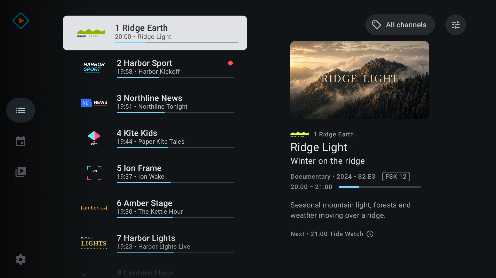
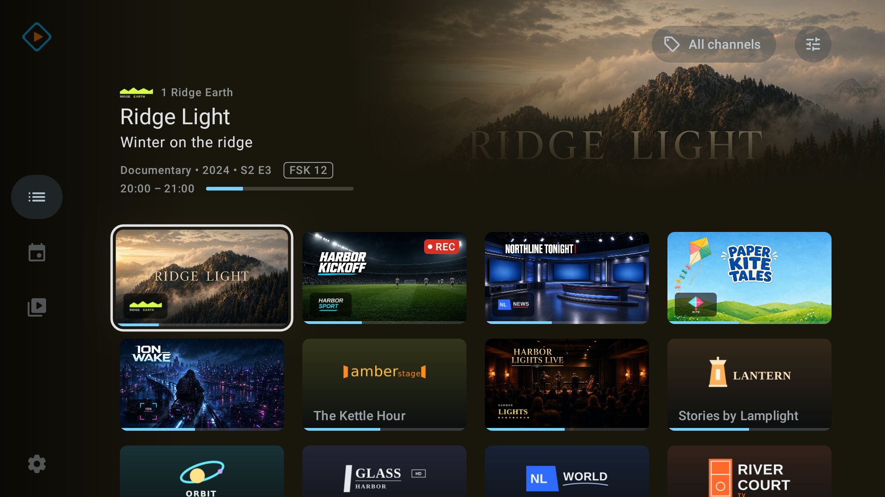
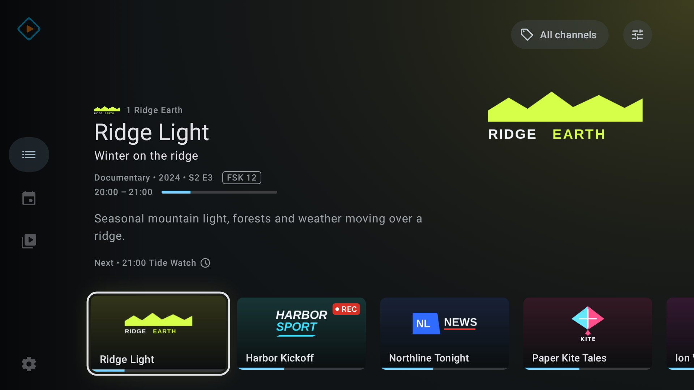
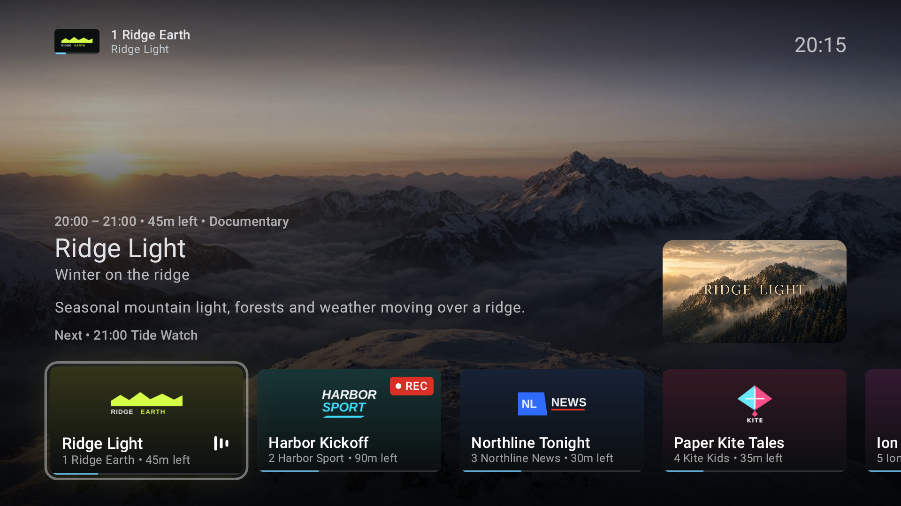
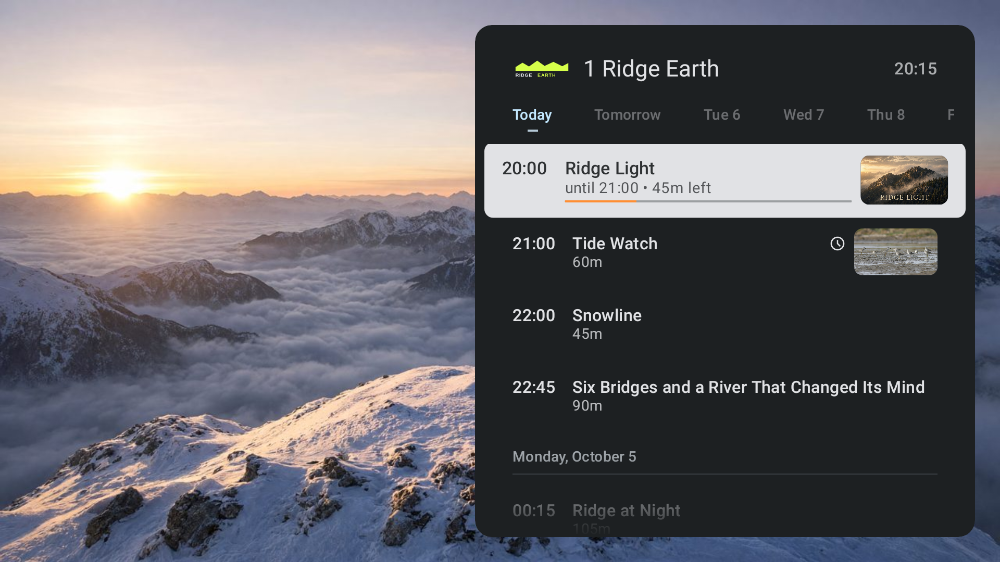
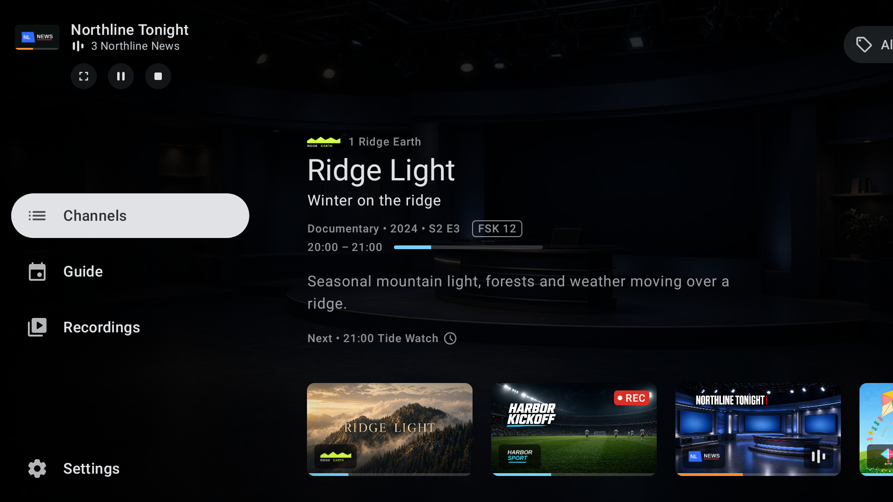
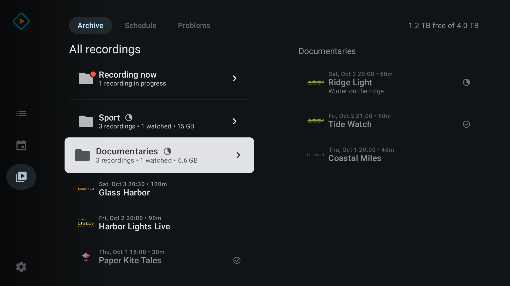

# Tvheadend Player

**A Tvheadend client for Android TV, built around the remote.**

Tvheadend Player is an Android TV and Google TV app for live TV, the program
guide and the recordings on your own Tvheadend server. You can do all of it with
the D-pad.

> [!IMPORTANT]
> The app is still in active development, and there's no stable release yet.
> It isn't an official Tvheadend app and isn't affiliated with or endorsed by
> the Tvheadend project.

| | | |
|---|---|---|
|  |  |  |
| Channels as a list | Channels as a grid | Channels without program pictures |

| | |
|---|---|
|  |  |
| Program guide | Program details |
|  |  |
| Player controls | Channel list in the player |
|  |  |
| Channel schedule | Side menu while TV keeps playing |
|  |  |
| Recording folders | A recording in a folder |

The screenshots show fictional channels and programs.

## Why I built it

I started this for my mum. When ORF retired Cryptoworks, the CI modules in her
TV stopped working. Instead of buying new modules I got her Google TVs, and
there was no Tvheadend app simple enough for her.

While looking for one I found
[tvhstream](https://github.com/Preclikos/tvhstream), and it sent me down a
rabbit hole. At first I wanted to contribute to it, and I did. But it soon
became clear that what I wanted to build went far beyond what I could
sustainably contribute to someone else's project, so I started my own. It
wouldn't exist without tvhstream as the inspiration.

After a while I wanted it for myself too. I wanted one polished live TV app for
Tvheadend that takes the bits I like from other apps, feels like it belongs on
the TV, and has the Material look Android users already know. It leans on what
Tvheadend is good at: timeshift on the server, live updates and recordings.
From Kodi I borrowed warm playback and making proper use of the TV's own player
and decoders. A mobile version might come later, but the TV comes first.

## What you need

- A Tvheadend server the TV can reach over HTSP, Tvheadend's streaming protocol.
  It has to speak HTSP 36 or newer, which means Tvheadend 4.3. 4.2 is too old,
  and the app tells you if your server is.
- An Android TV or Google TV device on Android 9 or newer.
- The TV's remote. Phones and tablets aren't supported.

## What it does well

- The screens are built from Google's Material Design for TV components, so the
  app looks like the rest of Android TV and Google TV.
- It talks to Tvheadend over HTSP, the server's own protocol. Pausing and
  rewinding live TV uses your server's timeshift buffer. When channels, the
  guide or recordings change on the server, Tvheadend sends the change and the
  screens update on their own.
- SD channels get the right shape. In Auto they show at exactly 16:9 or 4:3, the
  way a TV or set-top box shows them. You can also pick 16:9 or 4:3 for a single
  channel, and the app remembers it.
- On Android 11 and newer, the app can switch the TV to the frame rate Tvheadend
  reports for the channel, either always or only when the TV can switch without
  going dark.
- Audio passthrough is on by default, so surround sound reaches your soundbar or
  receiver unchanged.
- DVB and teletext subtitles work, in your preferred language or following the
  system caption settings.
- Tunneled playback is there as an experimental setting, off by default, under
  Settings → Playback. If the TV's decoder supports it, video goes straight from
  the decoder to the display instead of through the app.
- Live TV keeps playing behind the menus while you browse Channels, the guide or
  Recordings, with the picture or with just the sound. In the player, the
  channel list under the controls shows what's on everywhere else.
- Channels, the guide, Recordings and the details page show program pictures
  when Tvheadend has them, and channel logos and text when it doesn't. Logos are
  saved on the TV, so they still show when the server can't be reached.

Genre colors and the guide's genre filter rely on the DVB genre codes in your
guide data. If your XMLTV guide doesn't have them,
[xmltv-dvb-genres](https://github.com/bernhardberger/xmltv-dvb-genres) can add
them before Tvheadend imports it.

## What it does

**Live TV**

- Switch channels with channel up and down, from the channel list under the
  player controls, or by typing a channel number.
- Pause and rewind live TV, if your server has a timeshift buffer.
- Open the playing channel's schedule next to the picture.
- Pick audio and subtitle tracks and set your preferred languages.

**Channels**

- Browse channels as big picture cards, a grid or a list, with what's on now.

**Program guide**

- A widescreen guide with channels in rows and time across, a headline for the
  focused program, genre colors and a genre filter.
- Jump to another day and time, or back to now.
- One details page for every program, with the description, episode
  information, other airings and recording state.
- Watch, watch from the start, record or cancel a recording right from the guide.

**Recordings**

- Archive, Schedule and Problems tabs with your server's folders, plus a
  Recording now folder for whatever is being recorded at the moment.
- Play a recording, pick up where you stopped, and skip around with the remote.
- Mark recordings watched or unwatched, one at a time or a whole folder at once.
- Record, stop a running recording, and delete recordings.
- See how much recording space is left on the server.

What you can do, recording for example, depends on the permissions of your
Tvheadend account.

## Languages

The app is available in Chinese (Simplified and Traditional), Croatian, Czech,
Danish, Dutch, English, Finnish, French, German, Greek, Hungarian, Italian,
Japanese, Korean, Norwegian Bokmål, Polish, Portuguese (Brazil and Portugal),
Romanian, Russian, Spanish, Swedish, Turkish and Ukrainian. It follows the
system language, or you can pick one under Settings → General → App language.

Most of the translations are machine-generated (see
[How this app is made](#how-this-app-is-made)). If something reads wrong in your
language, please
[open an issue](https://github.com/bernhardberger/tvheadend-player/issues).

## Download and install

Download one APK from the
[latest release](https://github.com/bernhardberger/tvheadend-player/releases/latest):

| APK | Take it when |
|---|---|
| `…-play.apk` | You want the normal app. That's the one most people want. |
| `…-appliance.apk` | Your TV should start straight into the app. HOME opens it, and so does the GUIDE key once you turn on its accessibility service in Android settings. Not every TV's firmware allows this. |

The Appliance build is still a work in progress, so expect rough edges and
changes between releases. For everyday use, take the Play build.

You can install both side by side. To install an APK outside the Play Store,
allow installs from unknown sources for the app you open it with, a file manager
for example. I'm not promising a Google Play listing.

## First start

Setup takes three steps: Server, Account and Connect. The app first looks for
Tvheadend servers on your local network. If none answers, type in the server's
address and HTSP port. Then enter your Tvheadend username and password. The app
tests the connection before it saves anything, then loads your channels and
guide. To change the connection later, go to Settings → Connection → Set up
connection.

## Privacy

The app has no analytics, no ads and no account to sign up for. Your server
address and login stay on the TV, and the password is stored encrypted. Apart
from looking for Tvheadend servers on your local network during setup, the app
only talks to your Tvheadend server. The details are in the
[privacy policy](privacy-policy.md).

## How this app is made

I build Tvheadend Player with AI coding agents, and that's a deliberate choice:
one person couldn't build an app of this size in this time without them. The
agents write most of the code. I've been building software for over 20 years,
and I decide what the app should do, how it looks and works, and what goes into
a release. Changes are planned before they're made, reviewed by separate agents
and covered by tests, and I test each release on several real devices, from a
budget TCL Google TV to a Sony Bravia OLED and an NVIDIA Shield. What ships is
on me. Mistakes still slip through, so if something doesn't work or looks off,
please
[open an issue](https://github.com/bernhardberger/tvheadend-player/issues).

Apart from English and German, the translations are machine-generated and
checked by a second model, not by native speakers. Corrections are very welcome.

## Related projects

These are separate, unofficial projects of mine and aren't part of the Tvheadend
project.

- [tvheadend-htsp-kotlin](https://github.com/bernhardberger/tvheadend-htsp-kotlin):
  a Kotlin/JVM client library for HTSP, Tvheadend's protocol, covering HTSP
  versions 36 to 44. It's feature complete, and its first 1.0 release candidate
  is on Maven Central.
- [tvheadend-sdk](https://github.com/bernhardberger/tvheadend-sdk): a Kotlin SDK
  with JVM and Android libraries for apps that connect to Tvheadend. This app is
  built on it. It's still in development, and its API can change between
  releases.
- [xmltv-dvb-genres](https://github.com/bernhardberger/xmltv-dvb-genres): maps
  the category text in XMLTV guide data to the DVB genre codes Tvheadend
  understands. It comes with a mapping for Schedules Direct; other guide sources
  need their own table.

## License and source

Tvheadend Player is licensed under the
[GNU General Public License v3.0](LICENSE). Every GitHub release includes the
corresponding source for its APKs.

The code is a fork of [`Preclikos/tvhstream`](https://github.com/Preclikos/tvhstream)
and keeps its history and license. It's its own project now, and generic fixes
can still go back upstream. [`NOTICE.md`](NOTICE.md) lists the attribution
for the predecessor, artwork, dependencies and native libraries.

## Contributing

To build the app yourself or contribute, see [`CONTRIBUTING.md`](CONTRIBUTING.md).
Changes are listed in [`CHANGELOG.md`](CHANGELOG.md).
