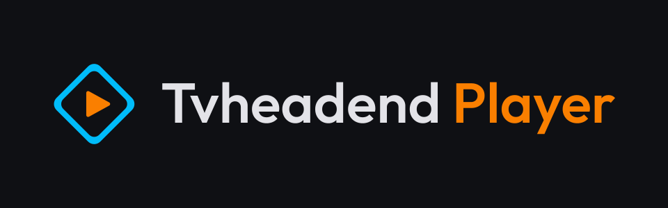
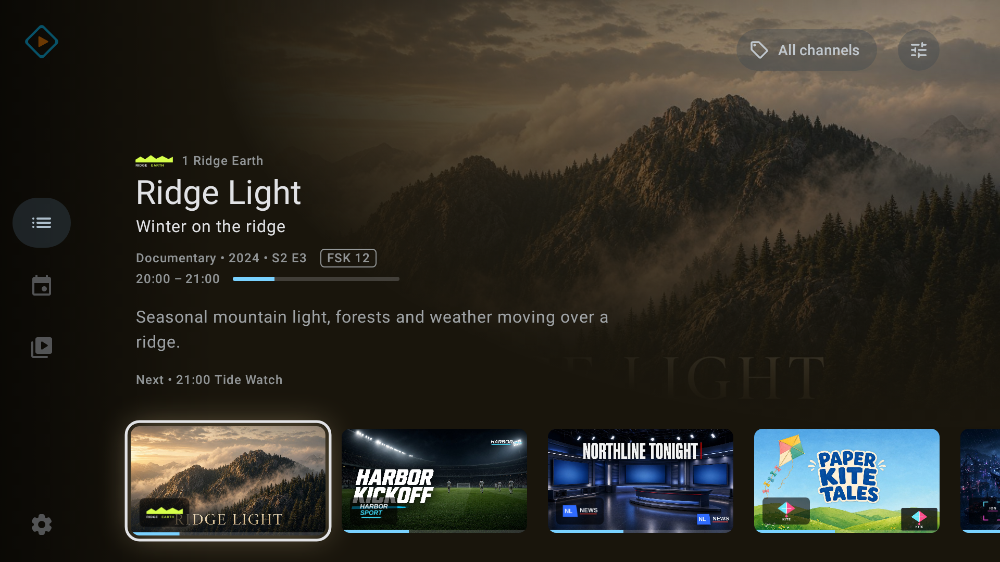
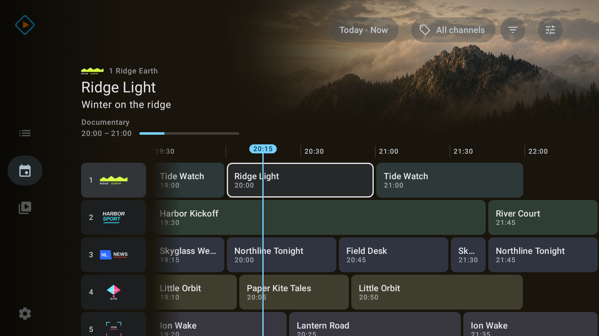
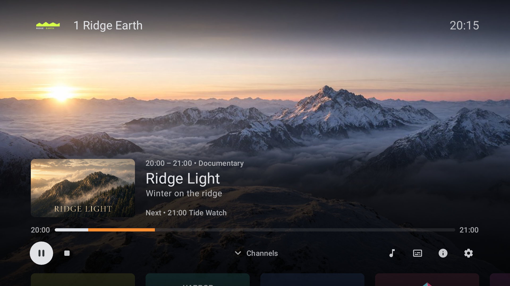
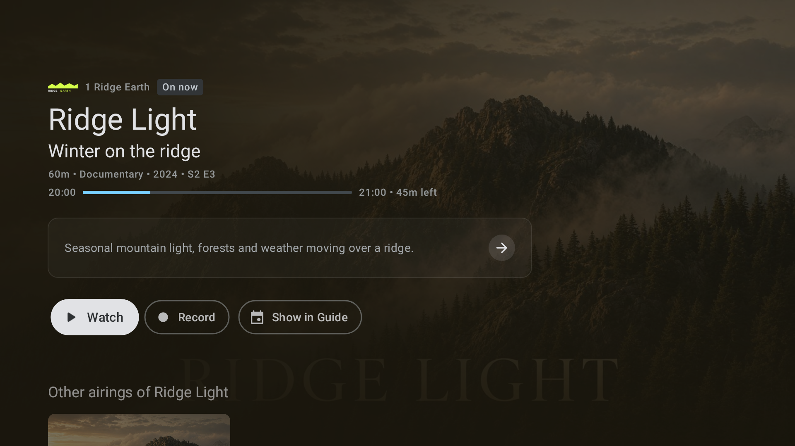
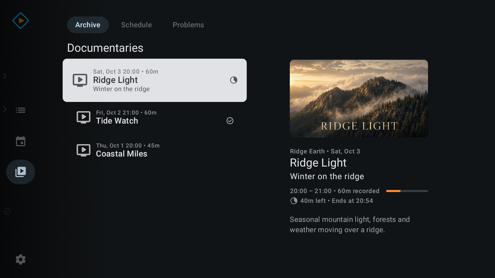

# Tvheadend Player

**A Tvheadend client for Android TV, built around the remote.**

Tvheadend Player brings live TV, a program guide and your recordings from your
own Tvheadend server to Android TV and Google TV. Everything works with the
D-pad.

> [!IMPORTANT]
> This project is under active development and does not yet have a stable public
> release. It is not an official Tvheadend application and is not affiliated
> with or endorsed by the Tvheadend project.

| | |
|---|---|
|  |  |
| Program guide | Player controls |
|  |  |
| Program details | Recordings |

The screenshots show fictional channels and programs.

## What you need

- A Tvheadend server that the TV can reach over HTSP, Tvheadend's streaming
  protocol. The server must speak HTSP version 36 or newer, which means a recent
  Tvheadend 4.3 development build; Tvheadend 4.2 is too old. If the server is
  too old, the app tells you so.
- An Android TV or Google TV device running Android 9 or newer.
- The TV's remote. Phones and tablets are not supported.

## What it does

**Live TV**

- Watch your channels and switch with channel up and down, from the channel list
  under the player controls, or by typing a channel number.
- Pause live TV and rewind, when your server provides a timeshift buffer.
- Open the playing channel's schedule beside the picture.
- Pick audio and subtitle tracks, and set preferred languages.
- Switch the TV to the video's frame rate, when the TV supports it.
- Choose what keeps playing behind the menus: the picture, only the sound, or
  nothing.

**Channels**

- Browse channels as large picture cards, a grid or a list, with what is on now.
- Saved channel logos stay visible while the server is unreachable.

**Program guide**

- A widescreen guide with channels in rows and time across, a headline for the
  focused program, genre colors and a genre filter.
- Jump to another day and time, or back to now.
- One details page for every program, with description, episode information,
  other airings and recording state.
- Watch, watch from the start, record or cancel a recording from the guide.

**Recordings**

- Archive, Schedule and Problems tabs with your server's folders, and a Recording
  now folder for what is recording at the moment.
- Play a recording, resume where you stopped, and jump with the remote.
- Mark recordings watched or unwatched, one at a time or a whole folder.
- Record, stop running recordings and delete.
- See the free recording space on the server.

Which actions you see, such as recording, depends on the permissions of your
Tvheadend account.

## Languages

Tvheadend Player is available in Chinese (Simplified and Traditional), Croatian,
Czech, Danish, Dutch, English, Finnish, French, German, Greek, Hungarian,
Italian, Japanese, Korean, Norwegian Bokmål, Polish, Portuguese (Brazil and
Portugal), Romanian, Russian, Spanish, Swedish, Turkish and Ukrainian. It follows
the system language, or you choose one in Settings → General → App language.

Most translations are machine-generated (see
[How this app is made](#how-this-app-is-made)). If a word or sentence reads wrong
in your language, please
[open an issue](https://github.com/bernhardberger/tvheadend-player/issues).

## Download and install

Open the [latest release](https://github.com/bernhardberger/tvheadend-player/releases/latest)
and download one APK:

| APK | Choose it when |
|---|---|
| `…-play.apk` | You want the normal app. Most people want this one. |
| `…-appliance.apk` | The TV should start straight into the app. HOME opens the app, and the GUIDE key does too once you turn on its accessibility service in Android settings. Not every TV firmware allows this. |

The Appliance build is a work in progress: expect rough edges and changes between
releases. Use the Play build for everyday use.

The two builds can be installed side by side. To install an APK without the
Play Store, allow installing from unknown sources for the app you use to open
it, such as a file manager. This project does not promise a Google Play listing.

## First start

Setup has three steps: Server, Account and Connect. The app first searches your
local network for Tvheadend servers; if none answers, type the server's address
and HTSP port. Then enter your Tvheadend username and password. The app tests
the connection before it saves anything, and loads your channels and guide. To
change the connection later, open Settings → Connection → Set up connection.

## Privacy

The app has no analytics, advertising or external account. Your server address
and login stay on the TV, and the password is stored encrypted. Apart from the
search for Tvheadend servers on your local network during setup, the app talks
only to your Tvheadend server. See the [privacy policy](privacy-policy.md).

## How this app is made

Tvheadend Player is built with heavy use of AI coding agents. I set the
direction, design the screens and decide what ships; agents write most of the
code under that direction, and separate agents review it. Every change goes
through automated tests (over 3,000), code review, and checks on a real
Android TV before release. I've been writing software for over 20 years, and
I'm responsible for all of it, whoever typed it.

Apart from English and German, the translations are machine-generated and
reviewed by a second model, not by native speakers. Corrections are very welcome.

## License and source

Tvheadend Player is licensed under the
[GNU General Public License v3.0](LICENSE). Each GitHub release includes the
corresponding source for the APKs.

The app descends from [`Preclikos/tvhstream`](https://github.com/Preclikos/tvhstream)
and keeps its history and license. It is now maintained as a separate project,
and generic fixes can still be passed back. [`NOTICE.md`](NOTICE.md) lists the
attribution for the predecessor, artwork, dependencies and native libraries.

## Contributing

To build the app yourself or contribute, see [`CONTRIBUTING.md`](CONTRIBUTING.md).
Changes are listed in [`CHANGELOG.md`](CHANGELOG.md).
