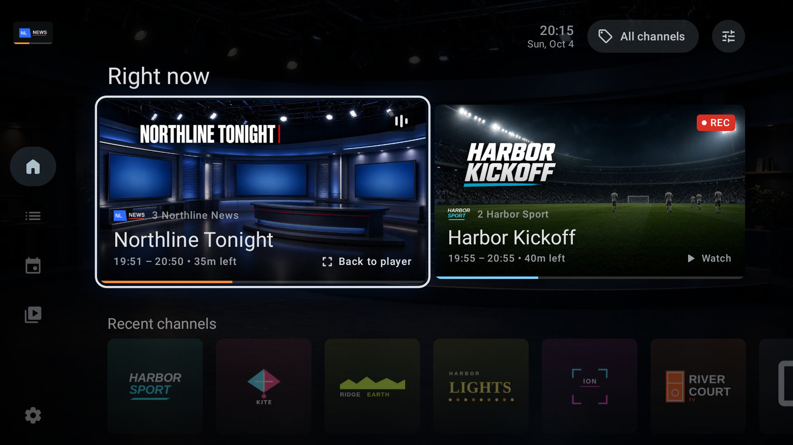
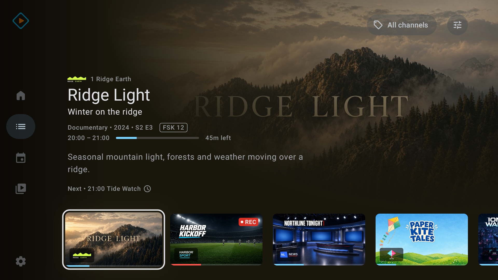
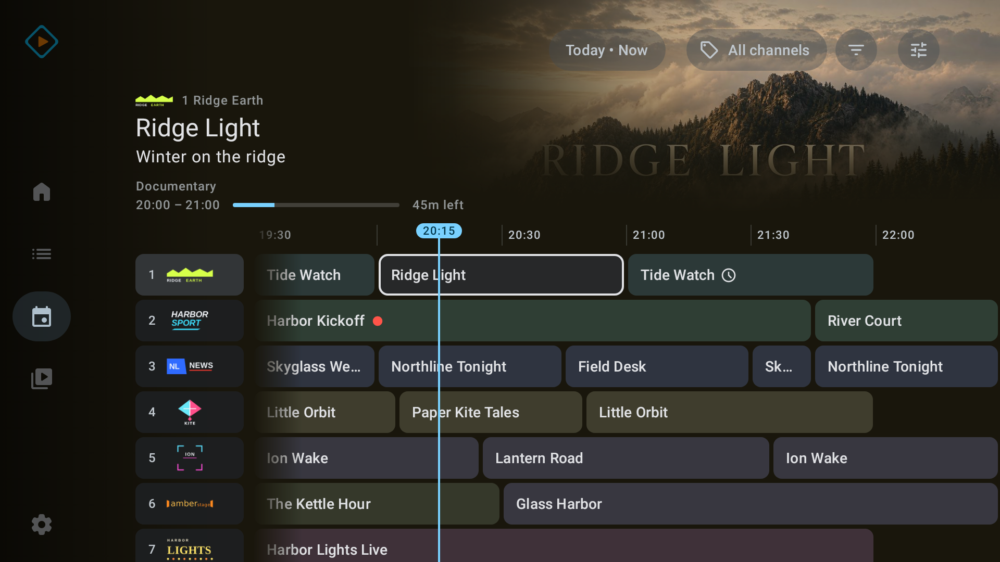
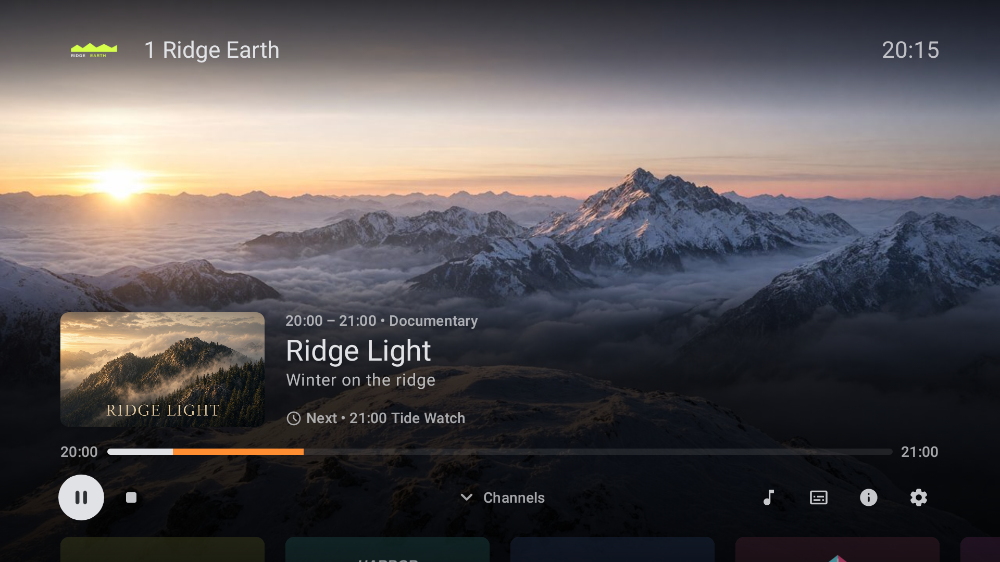
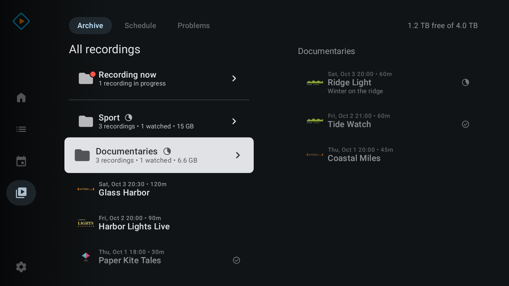

# 6. Testers

## 6.1 Invitations

Nothing is posted by agents. Post these only when the closed track has the
current release and the install path works on a real TV with your own account
(1.9). Before posting, `ROADMAP.md` and `artwork/screenshots/home.png` have to be
on `main`, because the posts link them.

Tvheadend forum, category Client Apps, and other forums. The screenshots are inline Markdown images;
check the preview, and attach them by hand if the forum doesn't render them:

```text
Tvheadend Player for Android TV: beta testers welcome

Hi all,

I'd like to invite you to the beta of Tvheadend Player, an unofficial open source (GPLv3) Android TV client for Tvheadend that started out as a fork of tvhstream. It's no relation to TVHplayer, mfat's desktop client. It's focused on a D-pad-first experience and follows Google's TV design guidelines.

What's in it so far:
- A home screen that shows what's going on right now and gets you back to what you were doing
- Channels with customizable views: an immersive list, a classic PVR-style list, or a grid to see more at a glance
- A program guide with genre colors and a genre filter
- Server timeshift support
- Recordings with a folder browser
- Audio passthrough, DVB and teletext subtitles, and frame rate switching on Android 11+

Everything goes over HTSP, with no analytics, ads or accounts.







Code and more screenshots: https://github.com/bernhardberger/tvheadend-player
Roadmap: https://github.com/bernhardberger/tvheadend-player/blob/main/ROADMAP.md

I'd love your feedback and ideas, and data points from setups other than mine. I can currently only test it on TCL and Sony TVs and an Nvidia Shield. The beta is also the way onto the Play Store, which will make it much easier for everyone to install.

I'm also interested in how others use Tvheadend. Our household's usage might be vastly different from yours, and the app might be a bit opinionated right now. I've tried my best to keep it neutral and fall back gracefully without artwork and with only EIT EPG data, but it might work and look best with a somewhat rich XMLTV guide.

You'll need an Android TV or Google TV device on Android 9+ and Tvheadend 4.3 (HTSP 36 or newer).

1. Join the group with the Google account on your TV: https://groups.google.com/g/tvheadend-player-testers
2. Opt in: https://play.google.com/apps/testing/at.bernhardberger.tvhplayer
3. Install it on the TV from the Play Store. It's not in search yet, so use the link from step 2.

Google needs at least 12 testers on the beta track for 14 days before the app can be published, so I'd appreciate it if you stayed for the 14 days and gave feedback.

Please report bugs on GitHub if you can: https://github.com/bernhardberger/tvheadend-player/issues
Feedback and discussion are welcome right here in this thread or in the beta Google group.

Prefer to skip Play? The APKs are on GitHub, signed with the same key, so you can switch either way.

For developers: the app is built on two libraries of mine that you can use for your own Tvheadend projects. tvheadend-htsp-kotlin is a Kotlin/JVM client library for HTSP, covering versions 36 to 44, with its first 1.0 release candidate on Maven Central: https://github.com/bernhardberger/tvheadend-htsp-kotlin
tvheadend-sdk is a Kotlin SDK for JVM and Android. It's still in development and its API can change between releases: https://github.com/bernhardberger/tvheadend-sdk
```

r/tvheadend, with `home.png`, `channels.png`, `guide.png` and `player.png` from
`artwork/screenshots/` as an image gallery. Check the
subreddit's rules for posts about your own project first:

```text
Title: Tvheadend client for Android TV, looking for beta testers

A bit of a backstory to this project: when our SAT provider retired Cryptoworks my mum's CI modules stopped working. I got her Google TVs instead of new modules, then couldn't find a Tvheadend app simple enough for her, so I started building one. It got a bit out of hand.

It's called Tvheadend Player, and it's no relation to TVHplayer, mfat's desktop client.

It's open source (GPLv3). Guide, timeshift, recordings, three channel layouts, and it all works with a plain D-pad remote.

It's in closed testing on Play right now. Google wants 12 testers for 14 days before it goes public. You need Tvheadend 4.3 and an Android TV or Google TV box on Android 9+:

1. Join the group with the Google account on your TV: https://groups.google.com/g/tvheadend-player-testers
2. Opt in: https://play.google.com/apps/testing/at.bernhardberger.tvhplayer
3. Install it from the Play Store on the TV. It's not in search yet, so use the link from step 2.

APKs are on GitHub if you don't want Play.

Bugs on GitHub please, everything else here.

I'm especially interested in setups other than mine, and data points are welcome. I can currently only test it on TCL and Sony TVs and an Nvidia Shield.

I'm also interested in how others use Tvheadend. Our household's usage might be vastly different from yours, and the app might be a bit opinionated right now. I've tried my best to keep it neutral and fall back gracefully without artwork and with only EIT EPG data, but it might work and look best with a somewhat rich XMLTV guide.

https://github.com/bernhardberger/tvheadend-player
Roadmap: https://github.com/bernhardberger/tvheadend-player/blob/main/ROADMAP.md
```

## 6.2 Tester instructions

Posted in the group as a welcome message:

```text
Thanks for testing Tvheadend Player.

1. Join this group with the same Google account that's signed in on your TV (you're here if you can read this).
2. Open this link on a phone or computer signed in with that account, and select "Become a tester": https://play.google.com/apps/testing/at.bernhardberger.tvhplayer
3. Install the app on your TV from the Play Store (still signed in with that account). The app doesn't show up in Play search yet, so use the link from step 2.
4. Please stay opted in for at least 14 days in a row and keep the app installed. Google requires those 14 days before the app can be published, so please don't opt out and back in. Leaving the group also removes you from the test.
5. Feedback: open an issue at https://github.com/bernhardberger/tvheadend-player/issues, post in this group, or leave private feedback on the app's Play Store page. Only I can read the private feedback.

If you have the GitHub APK installed, the Play version installs over it, and a newer GitHub APK installs over the Play version.

Some TVs, Sony for example, ship with a keyboard that makes you type through a phone app. If you can't type the server address, switch to Gboard: TV Settings, System or Device Preferences, Keyboard, Current keyboard.

Known problems in 0.4.0, all fixed in the next update:
- The server search can offer a long address starting with fe80 that won't connect. Type your server's IP address instead.
- Channel logos and programme pictures can stay missing after first setup. Force stop the app once (TV Settings, Apps) and open it again.
- Start watching at the end of setup may not look selected. Pressing OK still works.
- On TVs with Gboard, pressing OK on a text field can jump to the next field. Press Back twice, then move to the field you want.
```

Remove the known-problems list from the pinned text once 0.4.1 is live.

Step 3 isn't documented by Google for TVs; check it with your own account
first (1.9) and adjust the text. The last paragraph holds: Play App Signing
uses our key (SHA-256 checked in Console 2026-10-30, 1.2).
